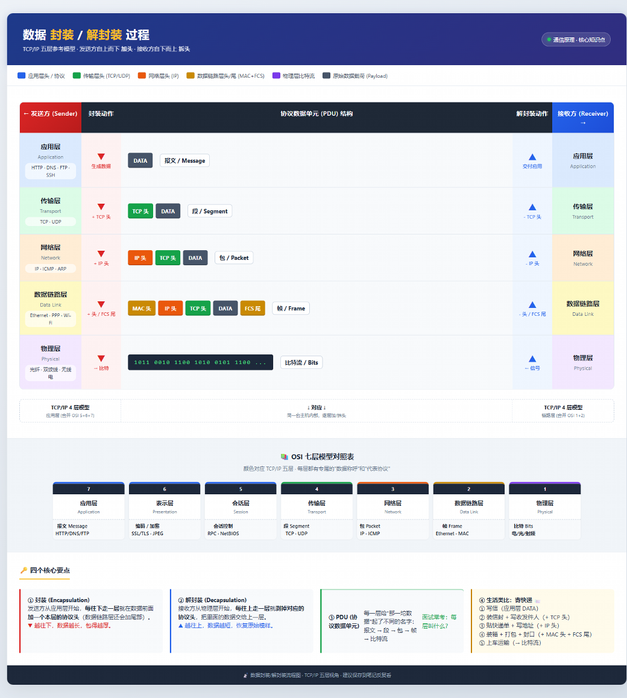

#### 1.1 tcp/IP 技术栈
-  **OSI 7层 /  tcp-ip 4层** 对应关系
**为什么先学这个？**
学会基础知识之后在使用wireshark、抓包、读漏洞原排查攻击，最后都会落到这几层上。不搞清楚“我现在看的是哪一层”，永远像看天书。

eg: OSI 7层 就像快递系统的7个工种
-  客服（应用层）——收件人发件
-  包装（表示层）——加固、加密
-  调度（会话层）——协调两边
-  长途司机（传输层）——一整车从A城送到B车城
-  路线规划（网络层）——决定走那条高速
-  匝道收银（数据链路层）——一段一段交接
-  路面（物理层）——真的把车开起来

OSI 7 层-表格

| 层   | 名字    | 协议               | 数据单元       |
| --- | ----- | ---------------- | ---------- |
| 7   | 应用层   | HTTP、DNS、FTP、SSH | 数据         |
| 6   | 表示层   | TLS加密、字符编码       | 数据         |
| 5   | 会话层   | session，token    | 数据         |
| 4   | 传输层   | TCP、UDP          | 段（Segment） |
| 3   | 网络层   | IP、ICMP、ARP      | 包（Packet）  |
| 2   | 数据链路层 | MAC、以太网、交换机      | 帧（Frame）   |
| 1   | 物理层   | 网线，光纤、WiFi       | 比特（Bit）    |

口诀：“物、数、网、传、会、表、应”（从下往上）

**TCP/IP 4层**
在互联网中实际使用的是这个。OSI是参考，TCP/IP 是真家伙：

| TCP/IP层 | 对应OSI    | 关键协议                   |
| ------- | -------- | ---------------------- |
| 应用层     | 应用+表示+会话 | HTTP、HTTPS、DNS、FTP、SSH |
| 传输层     | 传输层      | TCP、UDP                |
| 网络层     | 网络层      | IP、ICMP、ARP            |
| 网络接口层   | 数据链路+物理  | 以太网、WiFi、MAC           |

注意：很多人会问ARP算哪层？严格来说ARP在网络层和数据链路层之间，实战里归于网络成就好。

**数据封装过程**
发数据时从上往下加头（封装），收数据时从下往上拆头（解封装）：

每一层只关心自己的头，别的层它不管——这种解耦设计就是互联网能跑通几十年的根本原因。

**安全视角：每一层都有专属的攻击**

| 层   | 典型攻击                | 工具                |
| --- | ------------------- | ----------------- |
| 应用层 | SQL注入、XSS、SSRF、命令注入 | burp、sqlmap       |
| 传输层 | SYN flood、UDP flood | hping3、LOIC       |
| 网络层 | IP欺骗、ICMP重定向、Smurf  | scapy、hping3      |
| 链路层 | ARP欺骗、MAC泛洪         | arpspoof、ettercap |
| 物理层 | 搭线窃听、WiFi破解         | aircack-ng        |

记住这张表，学习每一个漏洞或者渗透时要记住自己打的是哪一层的漏洞

